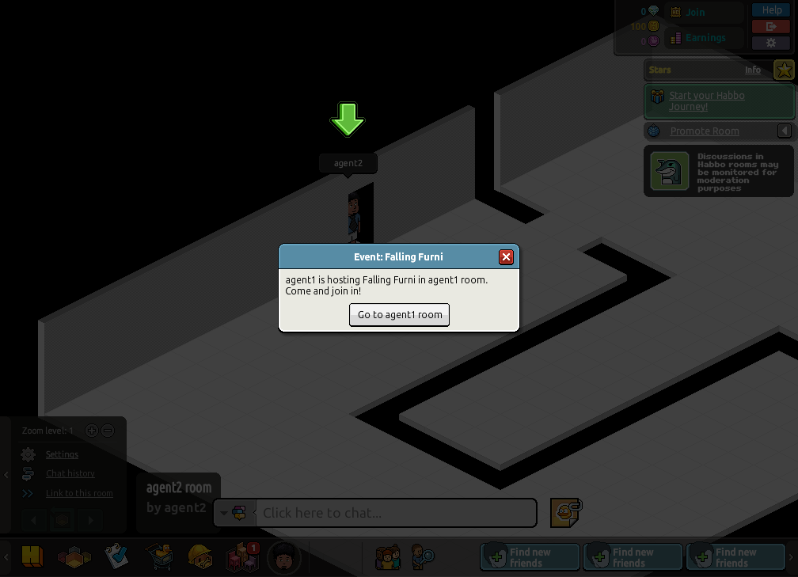
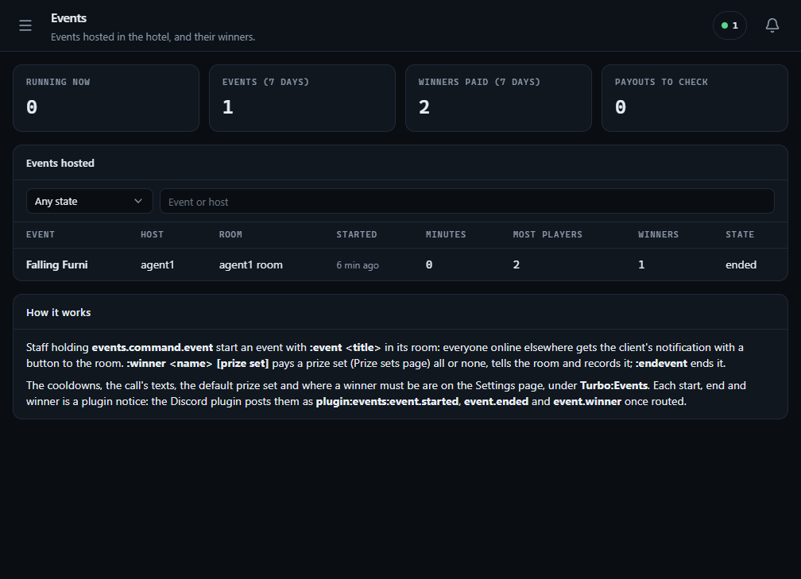
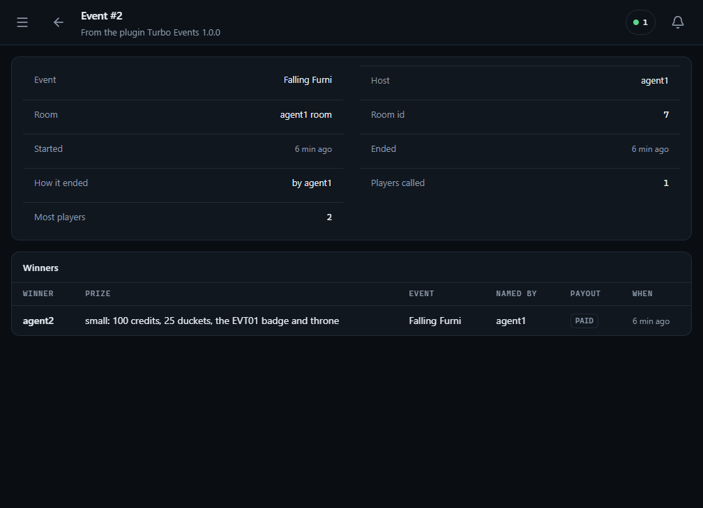
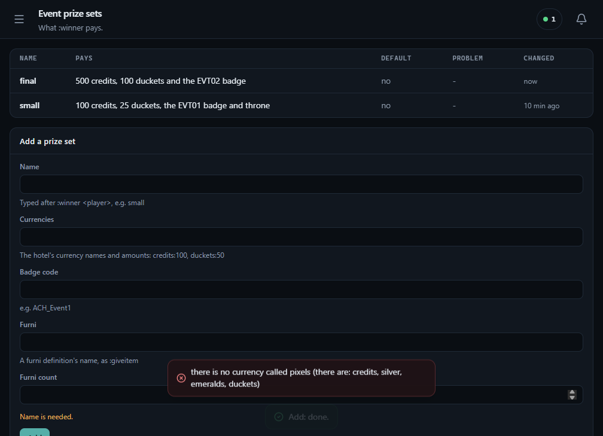
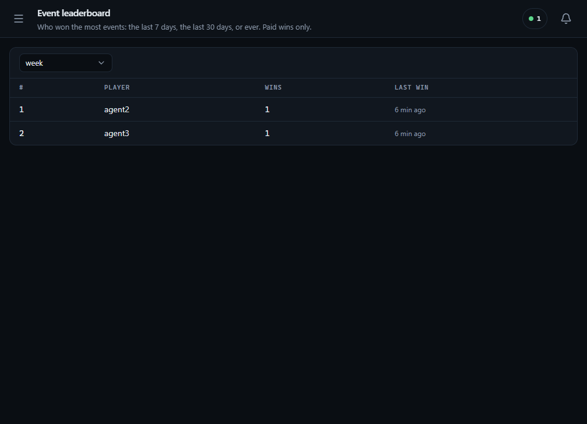

# Turbo Events plugin

What a hotel's event staff do every day by hand, for a [Turbo](https://github.com/nitrodevco/turbo-cloud)
hotel: host an event in a room, call the hotel to it, name the winners, pay their prizes, and keep a
record of all of it.

- **`:event <title>`** in a room calls everyone online elsewhere to it with the client's own
  notification: a pop-up with a button that takes them to the room (or, if the hotel prefers, a
  bubble in the corner that does). The host and the hotel wait out a cooldown between events.
- **`:winner <name> [prize set]`** pays a prize set (currencies, a badge, furni) all of it or none,
  tells the room in a bubble and records the win. A winner who is not in the room, or offline, is
  refused, saying which.
- **`:endevent`** ends the room's event. An event left running ends itself after a while.
- **Paid once.** A winner is written before anything is paid, and each step of the payout is saved
  as it is done, so a payout a restart broke off is finished, once, when the server is back.
- **On the admin panel:** the events hosted (with the most players their room held), every winner
  and what they were paid, a leaderboard (week, month, all time) and the prize sets.
- **Other plugins hear of it**, without this plugin knowing them: the Discord plugin can post each
  event started, ended and won.



## Commands

| Command | Node | |
| --- | --- | --- |
| `:event <title>` | `events.command.event` | Starts an event in the room it is typed in, and calls everyone online who is not in the room already. A room runs one event at a time. |
| `:endevent` | `events.command.endevent` | Ends the event running in the room it is typed in, whoever hosts it. |
| `:winner <name> [prize set]` | `events.command.winner` | Names the winner of the room's event and pays them the prize set, or `DefaultPrizeSet` when the line names none. |
| | `events.cooldown.bypass` | `:event` without waiting out the host's or the hotel's cooldown. |

No one holds the nodes until the hotel grants them (to its event staff's group, say, or a player),
or holds `*`. They are turbo-cloud chat commands (`docs/commands.md`), so core checks the nodes,
binds the arguments (`:winner` takes a player name as `:give` does), refuses a whisper or a muted
player, and writes each use to `command_logs` when the executor holds `command.log`. Every reply is
a hotel text, `command.<name>.<status>`, with a default in English: a hotel rewords or translates
them in its texts (`command.winner.offline` = `%0% is offline.`).

A call that reaches `Turbo:Commands:ConfirmAtPlayers` players or more (10 by default) waits for
`:confirm`, as core's own `:hotelalert` and `:eventalert` do. The cooldowns are checked first, so a
host is never asked to confirm a call that would be refused.

## Calling the hotel

The call is Habbo's own `NotificationDialog`, which every Habbo client draws: with the parameters
`title`, `message`, `linkTitle` and `linkUrl` = `event:navigator/goto/<room id>` it is the
notification pop-up, its button captioned `linkTitle`; a press takes the player to the room and
closes the pop-up (Habbo uses the same link for its own new-room notification). With `display:
BUBBLE` (`AlertAsBubble`) it is a corner bubble that takes them there when clicked. Its type
(`AlertType`, `events.started`) is the client's key for it: a hotel restyles it with a
`notification.events.started` external variable, and the client draws
`notifications/events_started.png` from the image library unless `AlertImage` names a picture.

A winner is told to the room the same way, as a bubble (`WinnerType`, `events.winner`), to everyone
who was in it when `:winner` was typed. The currencies the winner is paid show in the client's own
reward bubble, as `:give` does.

## Prizes

A prize set is any of: amounts of the hotel's currencies (by the names in `currency_types`, as
`:give` takes them: `credits:100, duckets:50`), a badge code, and a count of one furni (by its
definition name, as `:giveitem` takes it). It is checked when it is saved and again when it is paid:
a currency or furni the hotel does not have, or more than `MaxPrizeCurrency` / `MaxPrizeFurni`, is
refused.

A payout goes through the grains that own what it pays, never core's tables:

1. The winner's row is written, with a copy of the prize and a wallet operation of its own.
2. The currencies, as rewards under that operation: the wallet pays an operation once, however
   often it is asked.
3. The badge, if the winner does not have it already.
4. The furni, last, because nothing can take it back.

If a step fails, what the payout gave is taken back (the currencies under the same operation, the
badge only if this payout gave it) and the win is `failed`: no bubble, no notice. If the server
stops in the middle, the row is still `pending` and is paid on when the server is back, the steps
already done paying nothing twice. Furni alone has no receipt: a payout that stopped while furni was
being given is `unsure`, for staff to check the winner's inventory and mark settled on the panel,
rather than given twice.

## Settings

Under `Turbo:Events` in the server's configuration (`appsettings.json`, the environment:
`Turbo__Events__HostCooldownMinutes=60`, or the admin panel's Settings page while the plugin is
loaded). A change applies at once.

| Setting | Default | |
| --- | --- | --- |
| `HostCooldownMinutes` | 30 | How long a host waits after starting an event before starting another. 0: no wait. |
| `HotelCooldownMinutes` | 10 | How long the hotel waits after any event started before the next. 0: no wait. |
| `MaxEventMinutes` | 120 | An event still running this long after it started is ended. 0: never. |
| `MaxTitleLength` | 60 | The longest title. |
| `AlertType` | `events.started` | The call's notification type. |
| `AlertAsBubble` | false | A bubble instead of the pop-up. |
| `AlertTitle` | `Event: {title}` | The pop-up's title. Placeholders: `{host}` `{title}` `{room}` `{roomId}`. |
| `AlertMessage` | `{host} is hosting {title} in {room}. Come and join in!` | The call's text. |
| `AlertLinkTitle` | `Go to {room}` | The pop-up's button. |
| `AlertImage` | empty | A picture for the call (`${image.library.url}...` or https); empty: the type's own. |
| `DefaultPrizeSet` | empty | The prize set `:winner` pays when the line names none; empty: a line must name one. |
| `WinnerNeedsEvent` | true | Whether `:winner` needs an event running in the room. |
| `WinnerMustBeInRoom` | true | Whether the winner must be in the room. |
| `WinnerMustBeOnline` | true | Whether the winner must be online. Both off: an offline winner is paid and finds it at the next login. |
| `HostMayWin` | false | Whether whoever types `:winner` may name themselves. |
| `WinnerAnnouncement` | `{winner} won {title}: {prize}!` | The room's bubble; empty: none. Placeholders: `{winner}` `{prize}` `{title}` `{host}`. |
| `WinnerType` | `events.winner` | The bubble's notification type. |
| `WinnerImage` | empty | A picture for the bubble; empty: the type's own. |
| `MaxPrizeFurni` | 10 | The most furni one prize set may give. |
| `MaxPrizeCurrency` | 100000 | The most of one currency one prize set may give. |
| `AttendanceSampleSeconds` | 30 | How often the rooms of running events are counted for their peak. |

## Admin pages and permissions

**Events** (what runs now, the week's figures and the events hosted; one event's page with its
winners and a button to end it), **Event winners** (every winner, what they were paid; a pending
payout can be finished, an unsure one marked settled), **Event leaderboard** (paid wins in the last
7 days, 30 days or ever) and **Event prize sets** (add, change, remove; each set says what stops it
paying, if anything).

| Node | |
| --- | --- |
| `plugin.events.view` | See the Events pages. |
| `plugin.events.manage` | Change the prize sets, end events, finish or settle payouts. |

Declared by the plugin (Access in the admin panel lists them while it is loaded); no group holds
them until the hotel grants them, or holds `*`.

## Notices to other plugins

Each start, end and paid win is a turbo-cloud `PluginNoticeEvent` (`docs/plugin-notices.md`) from
`events`, keyed by the event's or the win's id. With the Discord plugin loaded they show on its
routing table as `plugin:events:event.started`, `plugin:events:event.ended` and
`plugin:events:event.winner`, off until the hotel routes them to a webhook. When the server has
`Turbo:Admin:PanelUrl`, a notice links to the event's page.

| Topic | Title | Fields |
| --- | --- | --- |
| `event.started` | `Alice started Falling Furni` | Host, Room, Called |
| `event.ended` | `Falling Furni ended` | Host, Room, Lasted, Most players, Winners |
| `event.winner` | `Bob won Falling Furni` | Winner, Prize, Awarded by |

## Privacy

The plugin keeps player ids and names, room ids and names, titles and prizes; no address, no chat.
Its notices say what the table above says, and nothing leaves the hotel unless another plugin
(Discord) is set to post them.

## Tables

`events_hosted` (each event: room, host, title, start and end, players called, peak),
`events_prize_sets` and `events_winners` (each win, a copy of its prize and how far its payout
went). No foreign keys into core. Uninstalling the plugin from the panel drops them.

## Build and install

The plugin is its sources: a Turbo server compiles `server/**/*.cs` as it loads the plugin
(turbo-cloud `docs/plugin-loading.md`), and its folder holds nothing built. `server/TurboEvents.csproj`
imports what the server compiles plugins with (`plugin-sdk/Turbo.Plugin.props` beside the server's
assemblies: the same references, C# and policy), so building it is the server's check:

```sh
TurboBin=/path/to/turbo-cloud/Turbo.Main/bin/Debug/net10.0 dotnet build server/TurboEvents.csproj
TurboBin=/path/to/turbo-cloud/Turbo.Main/bin/Debug/net10.0 ./scripts/package.sh
```

`TurboBin` is the bin folder of the server to build against (by default `../turbo-cloud`'s built
`Turbo.Main`). `package.sh` checks the sources compile, then leaves `dist/events/` with
`manifest.json` and `server/`. Copy that folder into the server's plugin folder
(`Turbo:Plugin:PluginFolderPath`, by default `plugins/` beside `Turbo.Main`), as `plugins/events/`,
or zip it and install it from the admin panel (Plugins, Install). On load the plugin creates its
tables through the server's own migrator, so the server's `Turbo:Database:Migrate` setting applies
to them as to core's tables. Then grant the command nodes to the event staff, and add a prize set.

### Releases

A server linked to this repository in the admin panel (Plugins, Link from GitHub) installs the
sources of its newest release's tag, GitHub's source archive: there is no built asset. Set the
manifest's `Version` (1.2.3), then push the tag `v1.2.3` (or name it in a manual run of Release,
which makes it on that commit): `.github/workflows/release.yml` checks the tag matches the
manifest, checks and tests the plugin against turbo-cloud's `main` and makes the release.
`ApiVersion` in the manifest is the turbo-cloud plugin API it is written for
(`Turbo.Contracts.Plugins.PluginApi`).

## Tests

```sh
TurboBin=/path/to/turbo-cloud/Turbo.Main/bin/Debug/net10.0 dotnet test tests/TurboEvents.Tests
dotnet tool restore && dotnet csharpier check .
```

The cooldowns (across a restart too), the call's parameters, ending and expiry, the peak, the
winner's checks, payouts all or none, paid once across a restart and unsure when furni was
interrupted, the commands as core's runner calls them (confirmation, the bypass node), the admin
endpoints and the leaderboard, over an in-memory SQLite database and a fake hotel.
`.github/workflows/ci.yml` runs both on every push and pull request against turbo-cloud's `main`.

## Migrations

```sh
TurboBin=/path/to/turbo-cloud/Turbo.Main/bin/Debug/net10.0 DesignTime=true dotnet ef migrations add <Name>   --project server/TurboEvents.csproj --context EventsDbContext --output-dir Database/Migrations
```

## Screens

| | |
| --- | --- |
|  |  |
| The events hosted: what runs now, the week's figures, each event's peak and winners. | One event: where, who, how it ended, and its winners with what they were paid. |
|  |  |
| The prize sets, and a set refused for a currency the hotel does not have. | The leaderboard: paid wins in the week, the month or ever. |
